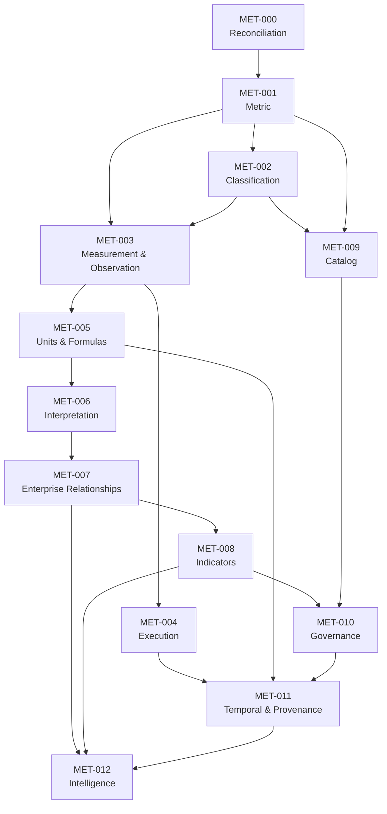

### OpenDEAM Metric Capability Programme — CR-MET-000 through CR-MET-012

We will establish the complete thirteen-CR programme, from existing-work reconciliation through to measurement analytics and decision intelligence.

I will preserve the scope and architectural intent of CR-MET-001 through CR-MET-005 already developed, and complete the programme around them.

The consolidated programme will therefore contain:

* CR-MET-000: Capability Establishment and Existing Work Reconciliation.

* CR-MET-001–005: Canonical Metric, Classification, Measurement, Observation, Execution and Measurement Semantics.

* CR-MET-006–008: Interpretation, Performance Indicators and Enterprise Integration.

* CR-MET-009–010: Metric Catalog and Governance.

* CR-MET-011–012: Temporal Measurement, Provenance, Analytics and Decision Intelligence.

One architectural principle governs the entire programme:

OpenDEAM must define a measurement capability, not merely a Metric entity.

The resulting capability must be usable by strategy, performance management, business architecture, risk, governance, digital maturity, operations, technology and AI-enabled decision intelligence.

### 1\. Consolidated CR register

| CR  | Title                                                      | Primary outcome                   |
| --- | ---------------------------------------------------------- | --------------------------------- |
| 000 | Capability Establishment and Reconciliation                | Authoritative baseline            |
| 001 | Canonical Metric Entity                                    | Metric semantics                  |
| 002 | Metric Classification and Taxonomy                         | Classification framework          |
| 003 | Measurement and Observation Entities                       | Measurement information model     |
| 004 | Measurement Lifecycle and Execution                        | Execution semantics               |
| 005 | Units, Formulas and Aggregation                            | Mathematical semantics            |
| 006 | Baseline, Target, Threshold and Performance Interpretation | Evaluation architecture           |
| 007 | Metric-to-Enterprise Entity Relationships                  | Cross-domain integration          |
| 008 | KPI, KRI and Performance Indicator Semantics               | Management indicator architecture |
| 009 | DEA Metric Catalog Repository                              | Reusable metric definitions       |
| 010 | Metric Governance, Quality and Conformance                 | Trust and lifecycle governance    |
| 011 | Temporal Measurement, Provenance and History               | Historical traceability           |
| 012 | Measurement Analytics and Decision Intelligence            | Enterprise intelligence           |

### CR-MET-000 — Metric Capability Establishment and Existing Work Reconciliation

Title: Establish the OpenDEAM Metric Capability and Reconcile Existing Metric-Related Architecture

Target: OpenDEAM architecture authority, `dea-metamodel`, relevant framework and governance repositories.

Change type: Architecture reconciliation, metamodel assessment and capability establishment.

### 1\. Background

Metric-related concepts already exist within the OpenDEAM development history.

In particular:

* CR-10J introduced Metric-related semantics, including definition, unit, calculation, source, baseline and target.

* CR-10 Outcome introduced metric-related references, baseline, expected outcome, target, unit, confidence, timeframe and evidence.

* Existing metamodel entities and relationships may already provide parts of the required measurement architecture.

* Existing identity, classification, relationship, governance and registry conventions must be reused.

The proposed Metric programme must not create a second semantic architecture alongside these existing constructs.

### 2\. Objective

Establish an authoritative baseline for the Metric capability and determine the exact changes required to progress it into a complete, governed OpenDEAM measurement architecture.

### 3\. Scope of discovery

The reconciliation must cover:

| Area           | Investigation                                        |
| -------------- | ---------------------------------------------------- |
| Metric         | Existing declarations, definitions and attributes    |
| Outcome        | Metric, baseline, target and evidence references     |
| Assessment     | Existing measurement and evaluation semantics        |
| Scenario       | Metric-related assumptions, outcomes and projections |
| Identity       | Canonical IDs, namespaces and versioning             |
| Classification | Existing taxonomies and classification assignments   |
| Relationships  | Entity association and cardinality conventions       |
| Governance     | Ownership, stewardship and lifecycle                 |
| Registry       | Entity and relationship generation                   |
| Validation     | Schema and semantic conformance                      |
| CI/CD          | Existing automation and repository workflows         |
| Documentation  | Entity templates and README standards                |

### 4\. Reconciliation disposition

Every discovered artifact must receive one of the following dispositions:

| Disposition | Meaning                                            |
| ----------- | -------------------------------------------------- |
| RETAIN      | Existing implementation is valid                   |
| EXTEND      | Existing implementation needs additional semantics |
| REFACTOR    | Existing structure needs redesign                  |
| CONSOLIDATE | Duplicate concepts must be unified                 |
| DEPRECATE   | Existing construct is no longer appropriate        |
| INTRODUCE   | A genuinely new construct is required              |

Each disposition must include evidence, rationale, impact and migration requirements.

### 5\. Required architectural decisions

CR-MET-000 must establish or confirm:

* Whether Metric already exists as a canonical metamodel entity.

* Whether its current attributes are semantically complete.

* Whether baseline and target belong to Metric or contextual evaluation objects.

* Whether Measurement and Observation already exist in equivalent forms.

* Whether the existing classification architecture is sufficient.

* Whether unit and formula semantics already exist.

* Whether measurement records belong in the metamodel, a catalog or runtime storage.

* Whether current Outcome and Assessment relationships require migration.

* Whether the existing registry supports the proposed extensions.

* Whether existing ADRs conflict with the proposed architecture.

### 6\. Required deliverables

* Metric capability architecture assessment.

* Existing entity and relationship inventory.

* CR-10J reconciliation report.

* CR-10 Outcome reconciliation report.

* Existing ADR dependency matrix.

* Proposed entity disposition register.

* Attribute and relationship migration matrix.

* Repository impact matrix.

* CI/CD impact assessment.

* Updated Metric capability roadmap.

* Approved implementation sequence.

### 7\. Acceptance criteria

* All relevant existing Metric constructs identified.

* CR-10J and CR-10 reconciled.

* Existing ADRs assessed.

* No duplicate entity architecture introduced.

* Existing identity and governance contracts respected.

* Metamodel changes identified precisely.

* Downstream migration implications documented.

* Repository ownership confirmed.

* CR-MET-001–012 dependencies approved.

* Architecture authority approves the baseline.

Implementation gate: No normative metamodel changes should be merged under CR-MET-001 until this reconciliation has been completed and approved.

### 2\. CR-MET-006 — Establish Baseline, Target, Threshold and Performance Interpretation

Critical

Title: Establish Contextual Measurement Evaluation and Performance Interpretation Semantics

Target repository: `dea-metamodel`

Dependencies: CR-MET-001, 003 and 005; ADR-MET-007.

### 1\. Background and problem statement

A Metric defines what is measured and how its value is determined. It does not necessarily establish whether the resulting value is good, bad, acceptable, expected or desirable.

That interpretation depends on additional information:

* The subject being measured.

* The applicable organizational context.

* The reporting period.

* The expected outcome.

* The baseline against which change is evaluated.

* The target being pursued.

* The threshold defining acceptable or unacceptable conditions.

* The relevant assessment criteria.

For example, a system availability observation of 99.5% has no universally valid performance interpretation. It depends on the service, contractual commitment, criticality and applicable evaluation period.

OpenDEAM must therefore separate measurement from evaluation.

### 2\. Objective

Establish reusable semantic constructs and relationships for evaluating observations against baselines, targets, thresholds, benchmarks and assessment criteria.

### 3\. Proposed conceptual architecture

| Concept                    | Canonical meaning                                       |
| -------------------------- | ------------------------------------------------------- |
| Baseline                   | Reference measurement or established starting condition |
| Target                     | Desired measurement result or performance level         |
| Threshold                  | Boundary used to classify or trigger an evaluation      |
| Benchmark                  | External or comparative reference                       |
| Expected Value             | Anticipated measurement result                          |
| Variance                   | Difference between an observed result and a reference   |
| Performance Interpretation | Meaning assigned to a result under defined criteria     |
| Assessment Criterion       | Rule used to evaluate a subject or result               |

These concepts must be modeled according to their independent semantics. They should not automatically become separate entity types merely because they appear in this table.

### 4\. Baseline semantics

A Baseline must represent a reference condition against which change, improvement or deterioration can be evaluated.

It must support:

* Reference Metric.

* Reference subject.

* Reference value or Observation.

* Establishment date.

* Applicable reporting period.

* Organizational scope.

* Measurement methodology.

* Source and evidence.

* Version and approval status.

A baseline may be:

* Historical.

* Initial.

* Strategic.

* Operational.

* Regulatory.

* Scenario-derived.

A baseline must preserve its historical validity even when a new baseline is established.

### 5\. Target semantics

A Target represents a desired or expected measurement result.

It must support:

* Associated Metric.

* Target subject and scope.

* Target value or range.

* Target direction.

* Effective period.

* Responsible owner.

* Associated objective or outcome.

* Approval status.

* Supporting rationale.

Targets must support multiple levels:

* Enterprise.

* Business domain.

* Business unit.

* Capability.

* Process.

* Product or service.

* Technology or system.

The same Metric may have different targets in different contexts.

### 6\. Threshold semantics

Thresholds establish boundaries for interpretation or action.

Examples:

| Threshold  | Illustrative interpretation          |
| ---------- | ------------------------------------ |
| Critical   | Requires immediate intervention      |
| Warning    | Indicates elevated concern           |
| Acceptable | Within defined tolerance             |
| Optimal    | Meets or exceeds desired performance |

Thresholds must support both directional models:

* Higher values may be better.

* Lower values may be better.

They must also support bounded optimum ranges, where neither an excessively high nor excessively low value is desirable.

### 7\. Variance and interpretation

The architecture should support calculated variance:

Variance = ObservedValue - ReferenceValue

Relative variance:

RelativeVariance =
\\frac{ObservedValue-ReferenceValue}{ReferenceValue}
\\times100

However, the sign and interpretation must account for the Metric's directionality.

For example, a 5% increase in customer retention is generally positive, while a 5% increase in incident frequency may be negative.

Variance should normally be calculated from an Observation and an explicitly selected reference, not stored as an intrinsic Metric attribute.

### 8\. Required relationships

| Source                     | Relationship                 | Target                 |
| -------------------------- | ---------------------------- | ---------------------- |
| Baseline                   | references                   | Metric                 |
| Baseline                   | applies to                   | Subject                |
| Target                     | specifies desired result for | Metric                 |
| Target                     | applies to                   | Subject                |
| Threshold                  | constrains/interprets        | Metric                 |
| Benchmark                  | compares against             | Metric                 |
| Performance Interpretation | evaluates                    | Observation            |
| Assessment Criterion       | evaluates                    | Subject or Observation |
| Outcome                    | is evaluated using           | Metric / Observation   |
| Strategic Objective        | is supported by              | Target                 |

Relationship names must be reconciled with the existing OpenDEAM relationship vocabulary.

### 9\. Implementation tasks

* Review existing baseline and target attributes.

* Reconcile CR-10 Outcome semantics.

* Define baseline semantics.

* Define target semantics.

* Define threshold semantics.

* Establish benchmark representation.

* Define directionality and tolerance.

* Establish variance calculation rules.

* Define performance interpretation semantics.

* Establish temporal validity.

* Define subject-specific target behavior.

* Update metamodel relationships and validation.

* Add representative examples.

* Update documentation and registries.

### 10\. Acceptance criteria

* Baseline separated from Metric definition.

* Target separated from Metric definition.

* Threshold semantics established.

* Benchmark semantics established.

* Directionality supported.

* Subject-specific targets supported.

* Multiple temporal targets supported.

* Variance semantics established.

* Performance interpretation is reproducible.

* CR-10 Outcome references remain compatible.

* Schema and relationship validation passing.

Key architectural decision: Baseline, Target and Threshold must be independently contextualizable and temporally valid. A Metric should not be forced to carry one permanent baseline or target.

### 3\. CR-MET-007 — Establish Metric-to-Enterprise Entity Relationships

Critical

Title: Establish Cross-Domain Metric Relationships and Enterprise Measurement Applicability

Target repository: `dea-metamodel`

Dependencies: CR-MET-001, 002, 003 and 006; ADR-MET-004 and ADR-MET-009.

### 1\. Background and problem statement

Metric must be a cross-cutting semantic concept within OpenDEAM.

An enterprise does not measure metrics in isolation. It measures characteristics and performance of business capabilities, processes, value streams, organizational units, products, services, technology, data and strategic objectives.

A Metric therefore needs to be associated with the enterprise entities it measures or helps evaluate.

However, association alone is insufficient. OpenDEAM must distinguish the semantic nature of each relationship.

For example:

* A metric measures a capability.

* A metric indicates progress towards an objective.

* A metric supports assessment of a process.

* A metric monitors a risk.

* A metric evaluates control effectiveness.

These relationships are not interchangeable.

### 2\. Objective

Establish a consistent cross-domain relationship architecture allowing Metric definitions and Observations to be reused throughout the enterprise metamodel.

### 3\. Relationship categories

The CR should establish the following relationship semantics.

| Category            | Meaning                                        |
| ------------------- | ---------------------------------------------- |
| Measurement         | Metric measures a subject                      |
| Performance         | Metric evaluates subject performance           |
| Monitoring          | Metric monitors a condition                    |
| Outcome             | Metric measures an intended outcome            |
| Assessment          | Metric supplies evidence for assessment        |
| Risk                | Metric supports risk monitoring                |
| Control             | Metric evaluates control effectiveness         |
| Quality             | Metric measures quality characteristics        |
| Capability          | Metric measures capability characteristics     |
| Strategic alignment | Metric provides evidence of strategic progress |

### 4\. Enterprise integration coverage

The CR must systematically assess relationships with the following entities.

| Enterprise domain        | Relevant entities                              | Example                   |
| ------------------------ | ---------------------------------------------- | ------------------------- |
| Strategy                 | Objective, strategy, initiative                | Objective attainment      |
| Organization             | Enterprise, business unit, organizational unit | Workforce productivity    |
| Business architecture    | Capability, function, process                  | Process efficiency        |
| Value architecture       | Value stream, value stage                      | Lead-to-cash cycle time   |
| Customer                 | Customer segment, journey, experience          | Customer retention        |
| Product and service      | Product, service, service offering             | Product defect rate       |
| Information architecture | Data entity, information object                | Data completeness         |
| Technology architecture  | System, component, infrastructure              | System availability       |
| Governance               | Risk, control, policy                          | Control effectiveness     |
| Transformation           | Transformation initiative, outcome             | Benefits realization      |
| Maturity                 | Maturity model, dimension, assessment          | Capability maturity score |

### 5\. Relationship semantics and cardinality

The implementation must support:

* One Metric measuring multiple subjects.

* Multiple Metrics measuring one subject.

* Multiple Observations for each Metric-subject combination.

* Different measurement contexts for the same Metric.

* Different targets for different organizational scopes.

* Metrics supporting several strategic objectives.

* Metrics associated with multiple assessments.

The model must also distinguish a Metric's intended applicability from an actual Measurement instance.

For example, a Metric may be defined as applicable to all business processes, while an actual Measurement references one specific process.

### 6\. Assessment and maturity integration

A particularly important requirement is integration with DMM and other maturity models.

Metric should be capable of supporting:

* Quantitative assessment evidence.

* Qualitative assessment evidence.

* Maturity scoring.

* Capability performance evaluation.

* Dimension-level evaluation.

* Pillar-level assessment.

* Transformation progress.

However, a maturity level must not automatically be interpreted as a universally comparable quantitative Metric.

The applicable maturity model defines its own assessment scale, criteria and interpretation rules.

### 7\. Implementation tasks

* Inventory existing enterprise entities.

* Inventory existing relationship definitions.

* Identify reusable generic relationship patterns.

* Define measurement relationship semantics.

* Define performance and monitoring relationships.

* Establish domain-specific applicability.

* Establish relationship cardinalities.

* Define inverse relationship navigation.

* Validate cross-domain references.

* Integrate with Assessment and Outcome.

* Add representative cross-domain examples.

* Update generated relationship registry and documentation.

### 8\. Required integration examples

At minimum, demonstrate:

* Metric measuring a Business Capability.

* Metric measuring a Business Process.

* Metric measuring a Value Stream.

* Metric supporting a Strategic Objective.

* Metric monitoring a Risk.

* Metric evaluating a Control.

* Metric supporting a DMM Assessment.

* Metric measuring Data Quality.

* Metric measuring Technology Reliability.

* Metric evaluating a Transformation Outcome.

### 9\. Acceptance criteria

* Cross-domain relationship architecture established.

* Existing relationship vocabulary reused.

* Relationship semantics explicitly differentiated.

* Cardinality constraints defined.

* Inverse relationships validated.

* Assessment integration established.

* Outcome integration established.

* Maturity integration established.

* Cross-domain examples validated.

* Registry and CI/CD updated.

Key architectural decision: Metric is a cross-domain measurement construct, not a property owned exclusively by any one enterprise architecture domain.

### 4\. CR-MET-008 — Establish KPI, KRI and Performance Indicator Semantics

High priority

Title: Establish Governed Management Indicator Designations and Semantics

Target repository: `dea-metamodel`

Dependencies: CR-MET-001, 002, 005, 006 and 007; ADR-MET-003 and ADR-MET-008.

### 1\. Background and problem statement

Not every Metric is a KPI, and not every KPI is a measure of financial performance.

Organizations use several types of indicators for performance management, governance, operational control and risk management.

OpenDEAM must represent these distinctions without fragmenting the Metric architecture into numerous unnecessarily specialized entities.

### 2\. Objective

Establish canonical semantics for management indicators and define how they are designated, governed and associated with Metrics.

### 3\. Indicator concepts

| Indicator             | Definition                                                                                                               |
| --------------------- | ------------------------------------------------------------------------------------------------------------------------ |
| KPI                   | Key Performance Indicator; a Metric designated as particularly important for evaluating performance against an objective |
| KRI                   | Key Risk Indicator; a Metric designated to monitor risk exposure, risk drivers or changes in risk conditions             |
| KCI                   | Key Control Indicator; a Metric designated to evaluate control operation or effectiveness                                |
| SLI                   | Service-Level Indicator; a Metric used to quantify a service characteristic or performance                               |
| Operational Indicator | A Metric designated for operational monitoring                                                                           |
| Leading Indicator     | An indicator providing evidence about potential future conditions                                                        |
| Lagging Indicator     | An indicator reporting realized historical conditions                                                                    |

Leading and lagging are measurement orientations, not substitutes for KPI or KRI designations.

### 4\. Classification versus specialization

The CR must evaluate three architectural options:

* KPI, KRI and KCI as independent entity types.

* KPI, KRI and KCI as specializations of Metric.

* KPI, KRI and KCI as governed designations applied to Metric.

Recommended decision: Use governed designations by default.

This allows one Metric to serve different management purposes without creating duplicate definitions.

Where a designation introduces materially different lifecycle, identity or governance requirements, a specialized construct may be justified through an ADR.

### 5\. Indicator designation model

A designation should support:

| Attribute            | Purpose                          |
| -------------------- | -------------------------------- |
| Designation type     | KPI, KRI, KCI, SLI, etc.         |
| Associated Metric    | Underlying Metric definition     |
| Management purpose   | Why the designation exists       |
| Associated objective | Relevant management objective    |
| Organizational scope | Scope of application             |
| Accountable owner    | Responsible management authority |
| Reporting frequency  | Required reporting cadence       |
| Target reference     | Applicable target                |
| Threshold reference  | Applicable threshold             |
| Escalation rules     | Required management response     |
| Effective period     | Validity of designation          |
| Approval status      | Governance approval              |

These attributes must not be copied indiscriminately into the Metric entity.

### 6\. KPI-specific requirements

KPI designation must require:

* A clear performance objective.

* An explicit relationship between the Metric and objective.

* A defined measurement method.

* A target or an explicitly documented reason for its absence.

* An accountable owner.

* A reporting and review arrangement.

* Defined interpretation criteria.

### 7\. KRI-specific requirements

KRI designation must support:

* Risk association.

* Risk appetite or tolerance context.

* Warning and critical thresholds.

* Risk exposure interpretation.

* Monitoring frequency.

* Escalation arrangements.

* Risk owner.

* Historical trend analysis.

A KRI must not be assumed to be a direct measurement of realized loss. It may measure an exposure, condition or driver associated with a risk.

### 8\. KCI-specific requirements

KCI designation must support:

* Associated control.

* Control objective.

* Control execution evidence.

* Control effectiveness criteria.

* Exception frequency.

* Control failure rates.

* Control owner.

* Remediation escalation.

### 9\. Implementation tasks

* Define canonical indicator terminology.

* Review existing OpenDEAM governance and risk constructs.

* Establish designation semantics.

* Define designation lifecycle.

* Define indicator-to-objective relationships.

* Define KPI-specific requirements.

* Define KRI-specific requirements.

* Define KCI-specific requirements.

* Establish SLI and operational indicator semantics.

* Define reporting and escalation references.

* Implement designation validation.

* Add examples and documentation.

### 10\. Acceptance criteria

* KPI semantics established.

* KRI semantics established.

* KCI semantics established.

* SLI semantics established.

* Classification versus specialization decision documented.

* Designations reuse canonical Metric identity.

* Objective and risk relationships established.

* Target and threshold references integrated.

* Designation lifecycle established.

* Representative examples validated.

Key architectural decision: A Metric remains a Metric regardless of its management designation. KPI, KRI and KCI represent management significance and intended usage, not necessarily different measurement definitions.

### 5\. CR-MET-009 — Establish the DEA Metric Catalog Repository

High priority

Title: Establish the Canonical DEA Metric Catalog and Reusable Metric Definition Repository

Target repository: `technehub-labs/dea-catalog-metrics` (proposed).

Dependencies: CR-MET-001 through CR-MET-008, with particular emphasis on CR-MET-001, 002 and 005.

### 1\. Background and problem statement

The metamodel defines what a Metric is. It does not provide the complete collection of reusable Metric definitions required across enterprise architecture domains.

OpenDEAM needs a dedicated catalog for publishing, discovering, referencing and reusing governed Metric definitions.

The catalog must become a semantic resource, not merely a list of KPIs.

It should support Metrics across strategy, organization, customers, business architecture, technology, data, risk, governance, sustainability and transformation.

### 2\. Objective

Establish a canonical Metric catalog repository aligned with the OpenDEAM metamodel, identity architecture, repository conventions, documentation standards and CI/CD pipeline.

### 3\. Repository positioning

The repository must:

* Consume the canonical entity definitions from `dea-metamodel`.

* Publish reusable Metric definitions.

* Support controlled Metric classifications.

* Maintain canonical entity identifiers.

* Document calculation methods.

* Establish relationships to relevant enterprise concepts.

* Support versioning and lifecycle management.

* Provide machine-readable and human-readable representations.

* Integrate with existing registry and validation tooling.

* Support contributions from multiple enterprise domains.

### 4\. Proposed repository structure

The exact structure must be aligned with existing DEA catalog repositories before implementation.

A proposed structure is:

```text
dea-catalog-metrics/
│
├── README.md
├── CONTRIBUTING.md
├── CHANGELOG.md
├── LICENSE
│
├── catalog/
│   ├── catalog.yaml
│   └── taxonomy/
│
├── entities/
│   └── v1-alpha/
│       ├── dea:metric-customer-retention-rate/
│       │   ├── entity.yaml
│       │   └── README.md
│       │
│       ├── dea:metric-mean-time-to-recovery/
│       │   ├── entity.yaml
│       │   └── README.md
│       │
│       └── dea:metric-data-completeness/
│           ├── entity.yaml
│           └── README.md
│
├── schemas/
│
├── templates/
│   ├── metric-entity.yaml
│   └── metric-readme.md
│
├── examples/
│
├── registries/
│
├── docs/
│
└── .github/
    └── workflows/
```

This is a proposed logical layout, not a mandate to duplicate structures already supplied by the DEA catalog template.

### 5\. Metric entity documentation standard

Every Metric must have a machine-readable definition and a comprehensive README.

The README template must cover:

| Section             | Required content                         |
| ------------------- | ---------------------------------------- |
| Identity            | Canonical identifier and name            |
| Definition          | Formal semantic definition               |
| Purpose             | Intended use                             |
| Classification      | Subject, purpose, nature and orientation |
| Measurement subject | What is measured                         |
| Unit or scale       | Measurement unit or scale                |
| Formula             | Calculation method and assumptions       |
| Inputs              | Required data and input definitions      |
| Source              | Authoritative data source                |
| Frequency           | Measurement frequency                    |
| Directionality      | Interpretation of higher/lower values    |
| Applicability       | Applicable organizational contexts       |
| Relationships       | Related enterprise entities              |
| Quality             | Quality and validation requirements      |
| Governance          | Owner, steward and approval              |
| Examples            | Illustrative calculation                 |
| Limitations         | Known exclusions and limitations         |
| Version             | Version and lifecycle status             |
| References          | Supporting standards and documentation   |

### 6\. Initial catalog content

The initial catalog should not attempt to publish hundreds of Metrics without semantic validation.

I recommend establishing an initial reference collection across different domains.

| Domain         | Reference Metric               |
| -------------- | ------------------------------ |
| Strategy       | Strategic Objective Attainment |
| Financial      | Operating Margin               |
| Customer       | Customer Retention Rate        |
| Organization   | Employee Engagement Score      |
| Operations     | Process Cycle Time             |
| Technology     | System Availability            |
| Data           | Data Completeness              |
| Risk           | Risk Exposure Index            |
| Governance     | Control Effectiveness Rate     |
| Transformation | Benefits Realization Rate      |
| Sustainability | Energy Consumption Intensity   |
| Capability     | Capability Performance Score   |

Each definition must be sufficiently complete to demonstrate the capabilities of the canonical metamodel.

### 7\. Catalog governance

The repository must establish:

* Metric contribution process.

* Definition review and approval.

* Canonical identifier assignment.

* Semantic duplicate detection.

* Classification consistency.

* Versioning.

* Deprecation.

* Cross-repository references.

* Domain stewardship.

* Provenance and source attribution.

Catalog contributions must not redefine the normative Metric entity.

### 8\. CI/CD integration

The catalog pipeline must validate:

* Metric schema compliance.

* Canonical identifier format.

* Required README sections.

* Taxonomy references.

* Unit and scale references.

* Formula syntax and metadata.

* Relationship integrity.

* Metric version references.

* Duplicate identities.

* Deprecated references.

* Documentation consistency.

* Registry generation.

It should reuse the existing DEA CI/CD tools wherever possible.

### 9\. Acceptance criteria

* Repository established.

* Repository README completed.

* Canonical metamodel dependency declared.

* Metric entity template established.

* Metric README template established.

* Canonical identity convention implemented.

* Initial reference Metrics documented.

* Classification references validated.

* Relationship references validated.

* CI/CD pipeline implemented.

* Registry publication operational.

* Contribution and governance documentation established.

Key architectural decision: The Metric catalog owns reusable Metric definitions, not the complete history of operational measurement observations.

### 6\. CR-MET-010 — Establish Metric Governance, Quality and Conformance

Critical

Title: Establish Metric Governance, Semantic Quality, Lifecycle and Conformance Framework

Target repositories: `dea-governance`, `dea-metamodel` and `dea-catalog-metrics`.

Dependencies: CR-MET-001 through CR-MET-009.

### 1\. Background and problem statement

The value of an enterprise Metric depends on the trustworthiness of its definition and the reliability of its measurement.

Without governance, organizations risk:

* Duplicate Metrics with conflicting meanings.

* Inconsistent calculation methods.

* Unapproved target changes.

* Unreliable source information.

* Untraceable observations.

* Incomparable measurements.

* Misleading enterprise performance reporting.

* Metrics that continue to be used after their definitions become obsolete.

OpenDEAM requires a formal governance framework covering the complete Metric lifecycle.

### 2\. Objective

Establish governance mechanisms for Metric definitions, measurement quality, observation integrity, semantic conformance and controlled change.

### 3\. Governance architecture

The CR must distinguish four governance objects:

| Governance concern     | Scope                                                  |
| ---------------------- | ------------------------------------------------------ |
| Definition governance  | Metric identity, semantics, classification and formula |
| Measurement governance | Execution methods, collection and validation           |
| Observation governance | Result integrity, provenance and quality               |
| Indicator governance   | KPI, KRI, KCI designation and management usage         |

Governance must be assigned at the appropriate level rather than treating all four as one approval process.

### 4\. Governance roles

| Role                 | Responsibility                                                        |
| -------------------- | --------------------------------------------------------------------- |
| Metric Owner         | Accountable for the Metric's business meaning and continued relevance |
| Metric Steward       | Maintains definition quality and semantic consistency                 |
| Measurement Owner    | Accountable for measurement execution                                 |
| Data Owner           | Accountable for authoritative source data                             |
| Data Steward         | Supports data quality and lineage                                     |
| Indicator Owner      | Accountable for KPI/KRI/KCI usage                                     |
| Governance Authority | Establishes policies and resolves governance exceptions               |
| Metamodel Authority  | Controls canonical semantic definitions                               |

One individual may fulfil multiple roles where appropriate, but accountability must remain explicit.

### 5\. Metric lifecycle

Proposed canonical lifecycle:

```text
Proposed
   |
   v
Under Review
   |
   v
Approved
   |
   v
Published
   |
   v
Active
   |
   +------> Under Revision
   |
   +------> Suspended
   |
   +------> Deprecated
                |
                v
             Retired
```

The final lifecycle vocabulary must align with existing OpenDEAM lifecycle conventions.

A Metric that is deprecated must not be silently deleted, particularly when historical Observations reference it.

### 6\. Metric quality framework

The CR should establish a reusable quality framework.

| Quality dimension | Evaluation                                         |
| ----------------- | -------------------------------------------------- |
| Semantic clarity  | Is the definition unambiguous?                     |
| Completeness      | Are all required attributes present?               |
| Consistency       | Does it conform to existing definitions?           |
| Validity          | Does the calculation produce meaningful results?   |
| Accuracy          | Does the measurement reflect the intended subject? |
| Timeliness        | Is the information sufficiently current?           |
| Reliability       | Can the measurement be reproduced?                 |
| Comparability     | Are values comparable across contexts?             |
| Traceability      | Can sources and calculations be reconstructed?     |
| Governance        | Are ownership and approval established?            |

The quality of a Metric definition must be distinguished from the quality of an individual Observation.

A perfectly defined Metric can produce poor-quality observations.

Conversely, an individual observation may be accurate even when the Metric definition has governance weaknesses.

### 7\. Conformance architecture

The CR must establish conformance rules at three levels.

Level 1 — Structural conformance

* Valid schema.

* Required attributes.

* Valid identity.

* Valid references.

* Valid data types.

Level 2 — Semantic conformance

* Unambiguous definition.

* Valid classification.

* Appropriate unit or scale.

* Valid formula semantics.

* Appropriate subject concept.

* Valid relationships.

Level 3 — Governance conformance

* Owner and steward.

* Approval status.

* Lifecycle compliance.

* Source documentation.

* Evidence requirements.

* Versioning.

* Change traceability.

### 8\. Governance change management

The CR must define the impact of changing:

* Metric definition.

* Measurement formula.

* Measurement unit.

* Classification.

* Measurement source.

* Directionality.

* Target.

* Threshold.

* Ownership.

* Reporting frequency.

Not every change requires a new Metric identity.

However, a change that alters the fundamental semantic meaning of a Metric must not be represented as a simple cosmetic version update.

The programme must establish a semantic-change assessment process to determine whether to:

* Revise the existing definition.

* Create a new version.

* Create a new Metric identity.

* Deprecate an existing Metric.

* Establish a replacement relationship.

### 9\. CI/CD and governance automation

The CR must establish automated governance checks for:

* Ownership completeness.

* Definition completeness.

* Duplicate detection.

* Invalid classifications.

* Invalid relationships.

* Unapproved changes.

* Deprecated references.

* Schema compatibility.

* Documentation completeness.

* Lifecycle consistency.

* Governance metadata.

* Cross-repository conformance.

Automation must identify violations and produce actionable reports.

It must not automatically approve semantically significant changes merely because schema validation passes.

### 10\. Acceptance criteria

* Metric governance responsibilities defined.

* Definition and measurement governance separated.

* Canonical lifecycle established.

* Metric quality framework established.

* Observation quality distinguished from Metric quality.

* Structural conformance implemented.

* Semantic conformance implemented.

* Governance conformance implemented.

* Semantic change management established.

* Deprecation and replacement semantics established.

* CI/CD governance checks implemented.

* Governance documentation published.

* Existing DEA governance authority integrated.

Key architectural decision: Metric governance is part of the wider DEA governance architecture. It must not establish an independent governance regime that conflicts with canonical OpenDEAM governance.

### 7\. CR-MET-011 — Establish Temporal Measurement, Provenance and History

High priority

Title: Establish Temporal Measurement Semantics, Historical Traceability and Provenance Architecture

Target repositories: `dea-metamodel`, `dea-governance` and future measurement runtime.

Dependencies: CR-MET-001, 003, 004, 005, 006 and 010; ADR-MET-010, 011, 012 and 014.

### 1\. Background and problem statement

Enterprise measurements are inherently temporal.

A measurement is meaningful only when its timing, reporting period, validity and measurement definition are understood.

Consider an enterprise reporting that its employee turnover rate is 12%.

That result is incomplete without knowing:

* Whether it represents a month, quarter or year.

* Which employee population was included.

* Which calculation method was used.

* Which organizational structure applied.

* When the data was captured.

* Whether the Metric definition has changed.

* Whether the value has subsequently been corrected.

OpenDEAM must therefore establish temporal and provenance semantics as first-class architectural concerns.

### 2\. Objective

Establish a reusable architecture for recording, tracing, reconstructing and interpreting historical Measurements and Observations.

### 3\. Temporal architecture

The CR must distinguish the following temporal dimensions.

| Temporal dimension | Meaning                                               |
| ------------------ | ----------------------------------------------------- |
| Observation time   | When the value was observed                           |
| Measurement time   | When the measurement was performed                    |
| Reporting period   | Period the result represents                          |
| Valid time         | Period during which the result applies                |
| Transaction time   | When the information was recorded in the system       |
| Effective time     | When a definition or configuration becomes applicable |
| Publication time   | When the result becomes available to consumers        |

These dimensions must not be collapsed into one timestamp.

### 4\. Reporting period semantics

The architecture must support:

* Instantaneous measurements.

* Point-in-time measurements.

* Fixed-duration reporting periods.

* Rolling periods.

* Cumulative periods.

* Event-based measurements.

* Irregular measurement intervals.

Examples:

* System availability measured continuously.

* Customer satisfaction measured monthly.

* Revenue measured quarterly.

* Strategic objective attainment measured annually.

* Incident recovery measured per incident.

### 5\. Provenance architecture

Every important Observation must be traceable to its origins.

The provenance model should support:

| Provenance element   | Description                            |
| -------------------- | -------------------------------------- |
| Source               | Original data source                   |
| Source record        | Specific originating record or dataset |
| Collection activity  | How information was acquired           |
| Calculation activity | How the result was derived             |
| Transformation       | Processing and conversion applied      |
| Agent                | Person, system or AI agent responsible |
| Configuration        | Measurement configuration used         |
| Formula version      | Calculation definition applied         |
| Metric version       | Metric definition applied              |
| Evidence             | Supporting source material             |
| Timestamp            | Relevant temporal information          |

The architecture should investigate alignment with W3C PROV concepts, including Entity, Activity and Agent, where appropriate.

It should reuse existing OpenDEAM provenance concepts if they already provide equivalent functionality.

### 6\. Historical reconstruction

A core requirement is the ability to reconstruct a previously reported result.

Given an Observation, the system should be able to identify:

* The Metric definition used.

* The Measurement configuration.

* The formula version.

* The source data.

* The transformations applied.

* The subject and organizational scope.

* The reporting period.

* The applicable baseline and target.

* The validation and approval status.

* Any subsequent correction or supersession.

This should enable reproducibility without requiring every historical result to be recalculated whenever a Metric definition changes.

### 7\. Correction and supersession

The architecture must distinguish:

* Original Observation.

* Corrected Observation.

* Superseded Observation.

* Invalid Observation.

* Retracted Observation.

Corrections must preserve historical auditability.

A correction must not silently overwrite the original value.

The relationship between original and corrected records must be explicit.

### 8\. Provenance and history integration

The CR must establish:

* Observation-to-provenance relationships.

* Measurement-to-source relationships.

* Formula-to-calculation relationships.

* Metric-version references.

* Historical definition preservation.

* Organizational-context history.

* Evidence retention references.

* Correction and supersession relationships.

### 9\. Implementation tasks

* Review existing temporal and provenance constructs.

* Establish temporal dimensions.

* Define reporting-period representation.

* Define valid-time and transaction-time semantics.

* Establish provenance relationships.

* Define historical Metric version handling.

* Establish formula-version traceability.

* Define correction and supersession.

* Establish reproducibility requirements.

* Assess W3C PROV interoperability.

* Define runtime storage implications.

* Implement representative temporal and provenance fixtures.

* Update schema and conformance validation.

* Document retention and audit requirements.

### 10\. Acceptance criteria

* Temporal dimensions established.

* Reporting periods formally represented.

* Valid-time and transaction-time semantics defined.

* Historical Metric definitions preserved.

* Formula-version traceability established.

* Provenance model established.

* Evidence traceability established.

* Corrections preserve historical records.

* Supersession semantics established.

* Historical reconstruction demonstrable.

* Runtime storage responsibilities documented.

* Conformance tests implemented.

Key architectural decision: Historical Observations must retain their original semantic context. Updating a Metric must not retrospectively change the meaning of previously recorded results.

### 8\. CR-MET-012 — Establish Measurement Analytics and Decision Intelligence Integration

Strategic capability

Title: Establish Measurement Analytics, Performance Intelligence and Decision Intelligence Integration

Target repositories: `dea-metamodel`, `dea-architecture-framework`, relevant analytics/runtime repositories and future measurement services.

Dependencies: CR-MET-001 through CR-MET-011; ADR-MET-009, 011, 013 and 016.

### 1\. Background and problem statement

The Metric capability becomes strategically valuable when measurement information can be used to understand enterprise conditions, evaluate performance, anticipate outcomes and inform decisions.

OpenDEAM must progress beyond simply storing Metrics and Observations.

It should enable an enterprise to answer questions such as:

* Are we achieving our strategic objectives?

* Which capabilities are underperforming?

* What is driving deterioration in operational performance?

* Are our investments producing the expected outcomes?

* Which risks are increasing?

* Where should transformation investments be directed?

* What is likely to happen if current performance trends continue?

* Which interventions are likely to produce the greatest improvement?

These require an integrated measurement intelligence architecture.

### 2\. Objective

Establish the architectural foundation for using Metric definitions, Measurements, Observations, Assessments, Targets, Outcomes and contextual enterprise information to support analytical and decision-intelligence capabilities.

### 3\. Analytical capability architecture

The CR should establish six complementary analytical capabilities.

### A. Descriptive analytics

Answers: What happened?

Examples:

* Current performance.

* Historical performance.

* Performance by organizational unit.

* Capability performance.

* Process performance.

* Technology reliability.

* Strategic objective attainment.

### B. Diagnostic analytics

Answers: Why did it happen?

Examples:

* Performance variance analysis.

* Contributing factor analysis.

* Root-cause investigation.

* Cross-domain correlation.

* Process bottleneck identification.

* Risk driver analysis.

### C. Predictive analytics

Answers: What is likely to happen?

Examples:

* Customer churn prediction.

* Capacity demand forecasting.

* Operational failure prediction.

* Revenue projections.

* Workforce attrition projections.

* Risk exposure forecasting.

### D. Prescriptive analytics

Answers: What should we do?

Examples:

* Recommended interventions.

* Resource allocation.

* Optimization recommendations.

* Capability improvement priorities.

* Risk mitigation recommendations.

* Transformation sequencing.

### E. Comparative analytics

Answers: How do we compare?

Examples:

* Organizational benchmarking.

* Business-unit comparison.

* Industry benchmarking.

* Historical comparison.

* Target versus actual.

* Capability maturity comparison.

### F. Scenario and simulation analytics

Answers: What would happen if?

Examples:

* Alternative investment scenarios.

* Transformation scenarios.

* Resource allocation scenarios.

* Operational capacity scenarios.

* Risk mitigation scenarios.

* Strategic outcome scenarios.

### 4\. Measurement intelligence architecture

The architecture should distinguish the following layers.

### Measurement intelligence stack

Enterprise Semantic Foundation

Metric · Measurement · Observation · Subject · Classification

Measurement Context

Baseline · Target · Threshold · Benchmark · Reporting Period · Provenance

Analytical Services

Descriptive · Diagnostic · Predictive · Prescriptive · Comparative · Simulation

Enterprise Decision Intelligence

Strategic Decisions · Investment Prioritization · Transformation · Performance Management · Risk Management

The layers describe architectural responsibilities, not necessarily separate repositories or deployable applications.

### 5\. Metric aggregation and cross-domain analytics

OpenDEAM must support aggregation across enterprise structures.

For example, an enterprise could aggregate:

* Process performance into value-stream performance.

* Capability performance into business-domain performance.

* Business-domain performance into enterprise performance.

* System availability into service reliability.

* Individual transformation outcomes into programme-level benefits.

However, aggregation must respect the mathematical and semantic rules established in CR-MET-005.

A simple arithmetic average must not be treated as a universal aggregation method.

The architecture must support:

* Aggregation by organizational hierarchy.

* Aggregation by business domain.

* Aggregation by time.

* Aggregation by capability.

* Aggregation by process.

* Aggregation by product and service.

* Aggregation by strategic objective.

* Aggregation across selected enterprise dimensions.

### 6\. Correlation and causal analysis

An important requirement is distinguishing correlation from causation.

For example:

An enterprise may observe that employee engagement and customer satisfaction increase together.

That does not automatically establish that employee engagement caused the improvement in customer satisfaction.

The architecture must support:

* Correlation references.

* Analytical hypotheses.

* Contributing factors.

* Causal relationships.

* Evidence supporting causal claims.

* Confidence and uncertainty.

* Model assumptions.

* Validation of analytical conclusions.

The Metric metamodel should not itself become a causal inference engine. It should provide the semantic references and provenance needed by analytical services.

### 7\. Predictive and AI-assisted measurement intelligence

The CR must establish integration requirements for AI-enabled analytical agents.

Potential capabilities include:

* Metric interpretation agents.

* Performance analysis agents.

* Trend detection agents.

* Anomaly detection agents.

* Forecasting agents.

* Root-cause analysis agents.

* Recommendation agents.

* Scenario simulation agents.

AI-generated outputs must be distinguishable from verified Observations.

The architecture must explicitly differentiate:

| Information type  | Meaning                                        |
| ----------------- | ---------------------------------------------- |
| Observation       | Recorded measurement result                    |
| Estimate          | Estimated value based on available information |
| Forecast          | Predicted future value                         |
| Simulation result | Output of a modeled scenario                   |
| Recommendation    | Suggested course of action                     |
| Decision          | Authorized management choice                   |

These must not be conflated or published as equivalent measurement facts.

### 8\. Integration with Assessment, Outcome and Decision

The CR must establish integration with existing OpenDEAM concepts.

| OpenDEAM concept    | Measurement intelligence role               |
| ------------------- | ------------------------------------------- |
| Metric              | Defines what is measured                    |
| Observation         | Provides measurement evidence               |
| Assessment          | Interprets evidence against criteria        |
| Outcome             | Describes an intended or achieved result    |
| Strategic Objective | Establishes strategic direction             |
| Scenario            | Supports alternative future analysis        |
| Decision            | Records an authorized choice                |
| Initiative          | Implements an intervention                  |
| Capability          | Provides an enterprise performance context  |
| Value Stream        | Provides value-delivery performance context |
| Risk                | Provides risk-monitoring context            |

A particularly important relationship is the connection between Outcome and Observation.

An Outcome may be supported by multiple Observations over time, while one Observation may contribute evidence to multiple related assessments or outcomes.

### 9\. Decision intelligence requirements

The architecture must support the following analytical-to-decision chain:

* Define the enterprise objective.

* Identify relevant Metrics.

* Establish baselines and targets.

* Collect Measurements.

* Record Observations.

* Assess performance.

* Identify deviations.

* Investigate contributing factors.

* Develop scenarios.

* Evaluate alternatives.

* Recommend interventions.

* Record decisions.

* Execute initiatives.

* Measure resulting outcomes.

This closes the feedback loop between enterprise strategy, execution, measurement and adaptation.

### 10\. Required implementation tasks

* Review existing Scenario and Decision constructs.

* Review Outcome and Assessment integration.

* Establish analytical capability boundaries.

* Define cross-domain aggregation requirements.

* Establish analytical result semantics.

* Define forecast and simulation result distinctions.

* Establish AI-assisted analytical output semantics.

* Define evidence and confidence references.

* Establish Metric-to-Decision traceability.

* Define analytical model provenance.

* Establish decision feedback relationships.

* Document integration contracts.

* Provide end-to-end reference scenarios.

* Update architecture and conformance documentation.

### 11\. Required reference scenarios

The implementation must demonstrate at least five end-to-end scenarios.

Scenario A — Strategic performance management

Enterprise objective → KPI → Measurement → Observation → Assessment → Strategic decision.

Scenario B — Digital maturity improvement

DMM dimension → Metric → Assessment evidence → Maturity evaluation → Improvement initiative → Outcome measurement.

Scenario C — Operational optimization

Business Process → Operational Metric → Performance variance → Root-cause analysis → Process intervention → Re-measurement.

Scenario D — Enterprise risk intelligence

Risk → KRI → Observation → Threshold breach → Risk assessment → Mitigation decision.

Scenario E — Transformation benefits realization

Transformation Initiative → Expected Outcome → Baseline → Target → Observations → Benefits realization assessment → Investment decision.

### 12\. Acceptance criteria

* Six analytical capability categories documented.

* Analytical result semantics established.

* Cross-domain aggregation architecture established.

* Mathematical aggregation constraints respected.

* Correlation and causality distinguished.

* Forecasts distinguished from Observations.

* Simulation results distinguished from actual measurements.

* AI-generated estimates distinguished from verified results.

* Assessment and Outcome integration established.

* Decision traceability established.

* Scenario integration documented.

* Five end-to-end reference scenarios validated.

* Analytics and runtime boundaries documented.

* Architecture documentation and registries updated where applicable.

Key architectural decision: OpenDEAM's Metric capability provides the semantic measurement foundation for enterprise decision intelligence. It should not absorb the responsibilities of analytical engines, forecasting platforms or workflow orchestration systems.

### 9\. Consolidated programme execution architecture

The complete CR programme now has three architectural development streams.

Stream A — Semantic and measurement foundation

CR-MET-000–005

* Existing architecture reconciliation.

* Metric definition.

* Classification.

* Measurement and Observation.

* Execution lifecycle.

* Units, formulas and aggregation.

Stream B — Enterprise interpretation and governance

CR-MET-006–010

* Baseline and target.

* Enterprise relationships.

* KPI/KRI/KCI.

* Metric catalog.

* Governance and conformance.

Stream C — Historical intelligence and decision support

CR-MET-011–012

* Temporal semantics.

* Provenance.

* Historical reconstruction.

* Analytics.

* Decision intelligence.

### 10\. ADR programme alignment

The CR programme should be governed by the following sixteen ADRs.

| ADR     | Architectural decision                      |
| ------- | ------------------------------------------- |
| MET-001 | Metric as a First-Class Entity              |
| MET-002 | Metric vs Measurement vs Observation        |
| MET-003 | Metric Classification Architecture          |
| MET-004 | Measurement Subject and Context             |
| MET-005 | Measurement Unit and Dimensionality         |
| MET-006 | Formula and Calculation Semantics           |
| MET-007 | Baseline, Target and Threshold Architecture |
| MET-008 | KPI, KRI and KCI Representation             |
| MET-009 | Metric Relationship Architecture            |
| MET-010 | Measurement Evidence and Provenance         |
| MET-011 | Temporal Measurement Architecture           |
| MET-012 | Measurement Quality and Confidence          |
| MET-013 | Composite Metrics and Aggregation           |
| MET-014 | Metric Governance and Lifecycle             |
| MET-015 | Runtime Measurement Architecture            |
| MET-016 | Metric Analytics and Decision Intelligence  |

The ADRs must be registered in the existing OpenDEAM ADR authority, retaining its canonical identifiers and lifecycle conventions. The MET identifiers above are programme references.

### 11\. Dependency and implementation roadmap



This is a logical dependency model; it does not require all CRs to be executed strictly sequentially. In particular, catalog preparation and governance design can progress alongside metamodel development, provided their normative dependencies are respected.

### 12\. Programme-wide Definition of Done

No single CR should be considered complete simply because its YAML definition has been added.

The programme must collectively demonstrate:

| Acceptance dimension   | Expected result                           |
| ---------------------- | ----------------------------------------- |
| Semantic integrity     | No conflicting definitions                |
| Entity architecture    | Canonical and reusable entities           |
| Identity               | Stable, governed identifiers              |
| Relationships          | Valid references and cardinalities        |
| Classification         | Consistent controlled vocabulary          |
| Measurement            | Typed and interpretable results           |
| Mathematical semantics | Reproducible calculations                 |
| Lifecycle              | Governed changes and historical integrity |
| Provenance             | Traceable measurement evidence            |
| Interoperability       | Reusable external semantic mappings       |
| Catalog                | Discoverable Metric definitions           |
| Automation             | CI/CD validation and registry generation  |
| Governance             | Accountable ownership and stewardship     |
| Intelligence           | End-to-end decision support               |

### 13\. Recommended implementation milestones

Milestone 1 — Foundation

CR-000–005

Canonical Metric and measurement architecture established and validated.

Milestone 2 — Enterprise integration

CR-006–008

Metrics can be interpreted and reused throughout OpenDEAM.

Milestone 3 — Governed catalog

CR-009–010

Reusable Metric definitions and formal governance are operational.

Milestone 4 — Measurement intelligence

CR-011–012

Historical traceability and enterprise decision intelligence are supported.

### 14\. Final architectural considerations before implementation

There are four decisions I would insist on resolving during the ADR work.

1\. Metric versus Indicator

Metric should be the foundational measurement definition. KPI, KRI, KCI and other indicators should generally be governed designations applied to Metrics.

2\. Metric versus Measurement versus Observation

These must remain separate semantic concepts. Otherwise, OpenDEAM will have difficulty preserving historical results and measurement reproducibility.

3\. Measurement semantics versus measurement runtime

The metamodel should define what constitutes a valid measurement, not prescribe the software infrastructure that collects and processes it.

4\. Metric versus Assessment

A Metric supplies measurement semantics and evidence. An Assessment applies criteria and interprets evidence. Neither should absorb the other's responsibilities.

These boundaries will be particularly important when connecting the Metric capability to DMM, business capability maturity, enterprise performance and transformation management.

### 15\. Expected outcome of the programme

By completion, OpenDEAM should possess:

* A canonical Metric metamodel.

* A complete measurement and observation model.

* A reusable classification architecture.

* Formal mathematical and measurement semantics.

* Contextual baselines, targets and thresholds.

* Cross-domain enterprise measurement relationships.

* KPI, KRI and KCI designation support.

* An authoritative Metric catalog.

* Integrated Metric governance.

* Historical measurement and provenance.

* Analytical and decision-intelligence integration.

* Automated repository validation and publication.

The strategic outcome is an enterprise-wide, framework-independent measurement foundation that allows OpenDEAM to connect enterprise intent, architectural structure, operational execution, observed performance and management decisions.

### Recommended next action

I recommend treating the thirteen CRs as the approved scope of the Metric capability initiative, but not yet as approved implementation changes.

The next implementation activity should be a repository-level reconciliation of `dea-metamodel`, the existing CR-10J and CR-10 work, the ADR register and the current CI/CD pipeline.

That review should establish the exact files, entities, relationships, naming conventions and automation affected by each CR. It will also identify which of the proposed ADRs are already covered by existing decisions.

This is the necessary step before translating these CRs into repository-specific implementation instructions and merging changes without introducing architectural duplication.